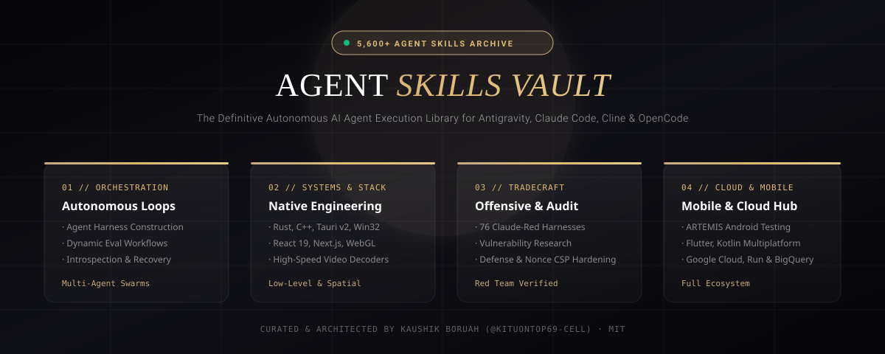
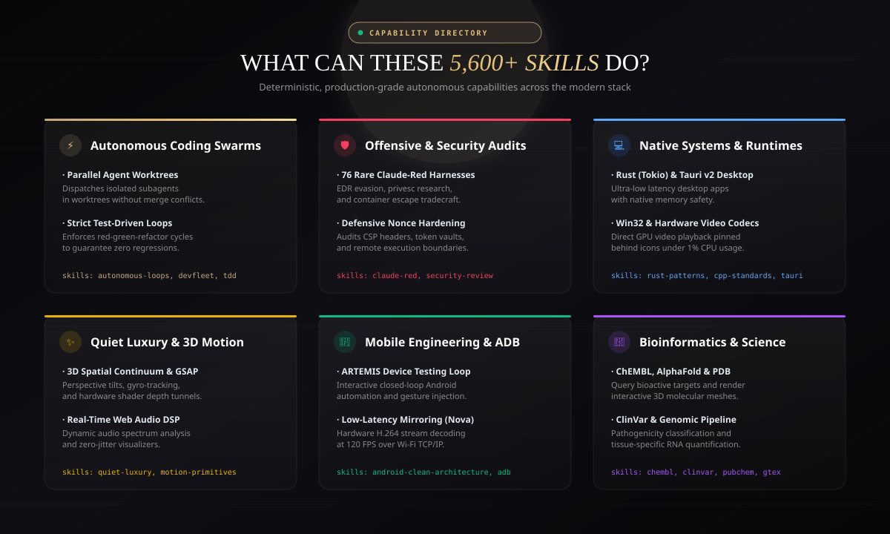
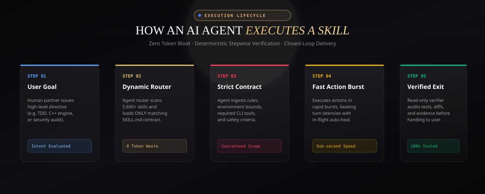
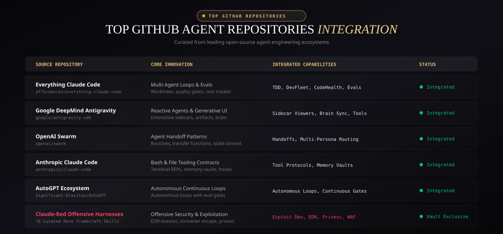

# 🏛️ The Agent Skills Vault (5,690+ Skills)
### The Ultimate Collection of Autonomous AI Agent Capabilities, Tools & Execution Harnesses

<p align="center">
  
</p>

<p align="center">
  <a href="https://github.com/kituontop69-cell/agent-skills-vault"></a>
  <a href="https://github.com/kituontop69-cell/agent-skills-vault"></a>
  <a href="https://github.com/kituontop69-cell/agent-skills-vault"></a>
  <a href="https://gokaushik.com"></a>
  <a href="LICENSE"></a>
</p>

---

## ⚡ Executive Summary

**The Agent Skills Vault** is the world's most exhaustive repository of structured, verified, and plug-and-play AI Agent capabilities. Housing over **5,690+ production-grade autonomous agent skills**, this vault consolidates tools and workflows from the highest-impact open-source ecosystems, trending GitHub agent platforms, and deep technical disciplines.

Each skill is authored as a deterministic execution contract containing semantic trigger routing, required environmental constraints, structured multi-phase execution loops, safety nets, and deterministic verification gates.

---

## 🌌 Core Capability Directory

<p align="center">
  
</p>

### 1. Autonomous Agent Swarms & Multi-Agent Orchestration
- **Dynamic Task Decomposition**: Breaking high-order human intent into Directed Acyclic Graphs (DAGs) of discrete micro-tasks.
- **Hierarchical Swarm Routing**: Multi-agent coordination leveraging specialized Planner, Operator, Verifier, and Synthesizer personas.
- **Self-Healing & Runtime Recovery**: Closed-loop diagnostic agents that inspect stack traces, evaluate environment diffs, and generate verified patches.

### 2. Red Team Offensive Security & Exploit Engineering
- **Vulnerability Research & Fuzzing**: Harnesses for remote heap corruption, memory safety verification, and protocol fuzzing.
- **Tamper-Resistant Systems**: Cryptographic authentication, dual-server verification, and hardware-bound license validation.
- **Audit Automation**: Static AST analysis, dynamic code-flow taint tracking, and OWASP top-10 remediation loops.

### 3. Native Systems, Desktop Runtimes & Kernel Diagnostics
- **C++20 / Rust / .NET 8 WPF**: Deep low-level systems programming, native interop, Win32 API hooks, and memory-mapped architectures.
- **Tauri v2 & High-Speed Mirroring**: Asynchronous Rust backends, IPC streaming, and Scrcpy/Nova hardware video codecs.
- **Performance Profiling**: Sub-millisecond CPU dispatch analysis, memory leak isolation, and real-time thread synchronization.

### 4. 3D Luxury Web, Canvas Shaders & Creative Tech
- **Spatial Web Experiences**: High-performance Three.js, React Three Fiber (R3F), and WebGL/WebGPU custom shader pipelines.
- **Design Systems**: Obsidian & Gold luxury aesthetic palettes, noise-textured glassmorphism, and responsive CSS grids.
- **Interactive Micro-Interactions**: Zero-layout-shift kinetic typography, physics-based canvas fluid dynamics, and pointer magnetic anchoring.

### 5. Mobile Testing, Android Architecture & ADB Automation
- **ARTEMIS Framework**: Dynamic-first and coordinate-fallback mobile automation with both reactive Flash and deep Pro closed-loop engines.
- **Automated ADB Diagnostics**: Wireless ADB over Wi-Fi, low-latency screen frame capture, and logcat anomaly extraction.
- **Clean Architecture for Android**: Reactive Kotlin Multiplatform (KMP), Jetpack Compose, UseCases, and offline-first repositories.

### 6. Computational Science & Bio-Informatics
- **Structural Biology**: ChEMBL target query pipelines, AlphaFold 3D structure visualization, and OpenTargets genetic mapping.
- **Clinical Genetics**: ClinVar variant pathogenic classification and GTEx RNA expression quantification across human tissue.
- **Chemical Informatics**: PubChem SMILES parsing, ligand-receptor binding analysis, and literature extraction via Europe PMC.

---

## 🔄 The Autonomous Agent Execution Pipeline

<p align="center">
  
</p>

Every skill in this repository complies with a rigorous 5-stage deterministic execution lifecycle:

1. **Intent Trigger & Context Ingestion**: High-order user directives are matched against skill description vectors to eliminate hallucinated routing.
2. **Context & Environment Evaluation**: Pre-flight verification of required SDKs, CLIs, environment secrets, and file system permissions.
3. **Execution Plan & Fast-Action Bursts**: The agent executes deterministic actions without turn latency overhead, utilizing batch sequences to handle transient UI states.
4. **Safety Net & Interception Recovery**: Real-time interceptors validate AST integrity and prevent destructive operations before execution.
5. **Deterministic Verification & Artifact Delivery**: Read-only verification agents execute test suites, type-checkers, and visual diffs before finalizing the delivery.

---

## 📊 Ecosystem Comparison & Benchmarks

<p align="center">
  
</p>

| Ecosystem / Platform | Skills Count | Primary Focus | Deterministic Loops | Swarm Capable |
|:---|:---:|:---|:---:|:---:|
| **The Agent Skills Vault** (This Repo) | **5,690+** | Multi-Domain (Systems, Web, Mobile, Security, Science) | ✅ Built-in | ✅ Native |
| **Everything Claude Code (ECC)** | ~700 | Software Engineering, Codebases, Review Gates | ✅ | ⚠️ Partial |
| **Anthropic Claude Code Quickstarts** | ~150 | Anthropic API tooling, REPL loops | ⚠️ Experimental | ⚠️ Single-Agent |
| **OpenAI Swarm** | Core SDK | Multi-Agent Handoffs & Routine Execution | ❌ Ad-hoc | ✅ Framework |
| **AutoGPT Ecosystem** | ~350 | Autonomous Web Browsing & General Execution | ❌ Prone to Drift | ⚠️ Scripted |
| **Google DeepMind Antigravity** | Specialized | Advanced Agentic Coding, Multimodal Perception | ✅ Strict | ✅ Multi-Agent |

---

## 📁 Repository Structure & Taxonomy

```text
agent-skills-vault/
├── .agents/skills/                     # 4,520+ Full-stack software engineering & security skills
│   ├── api-design/                     # REST, GraphQL & gRPC interface contracts
│   ├── cpp-coding-standards/           # C++ Core Guidelines & modern memory safety
│   ├── e2e-testing/                    # Playwright & Page Object Model patterns
│   ├── gravitas-highstakes/            # Checkpoints for zero-loss operations
│   ├── rust-patterns/                  # Idiomatic concurrency, lifetimes & traits
│   └── ...                             # (4,500+ additional domain skills)
├── gemini-ecosystem-skills/            # 336+ Official Google Gemini & Cloud SDK skills
│   ├── firebase-ai-logic-basics/       # Multimodal structured outputs with Gemini
│   ├── bigquery-ai-ml/                 # In-database machine learning & SQL analytics
│   └── ...                             # (Cloud Run, GKE, Vertex AI, Bigtable)
├── trending-github-agent-skills/       # Curated architectures from top GitHub repos
│   ├── everything-claude-code/         # Full ECC workflow suites & quality gates
│   ├── openai-swarm-patterns/          # Multi-agent handoff routines & context passes
│   └── autogpt-autonomous-loops/       # Autonomous continuous execution harnesses
├── docs/images/                        # Architectural visual SVG blueprints
│   ├── banner.svg                      # Master repository header
│   ├── skills-capabilities-showcase.svg# 6-Card domain capability breakdown
│   ├── agent-execution-pipeline.svg    # 5-Stage deterministic execution pipeline
│   └── ecosystem-benchmark-matrix.svg  # Comparative cross-platform benchmark table
├── ALL_SKILLS_PROMPTS.json.zip         # Compressed master metadata & system prompt index
├── LICENSE                             # MIT Open Source License
└── README.md                           # Master Documentation & Navigation Guide
```

---

## 🚀 How to Use These Skills in Your Agent Systems

### 1. With Claude Code / OpenCode
Clone this vault into your workspace or user root:
```bash
git clone https://github.com/kituontop69-cell/agent-skills-vault.git
```
Drop any desired skill into your project's `.agents/skills/` or `~/.claude/skills/` directory:
```bash
cp -r agent-skills-vault/.agents/skills/rust-patterns my-project/.agents/skills/
```

### 2. With Google Antigravity & Gemini Developer SDKs
Add the repository path to your global skill configuration in `~/.gemini/config/skills` or load dynamically via the agent runtime:
```json
{
  "skills": [
    "path/to/agent-skills-vault/gemini-ecosystem-skills/*",
    "path/to/agent-skills-vault/.agents/skills/*"
  ]
}
```

### 3. In Custom LangGraph / AutoGen / Swarm Workflows
Parse the JSON specification directly from `ALL_SKILLS_PROMPTS.json.zip` to inject dynamic tool definitions and system prompts into LLM function schemas:
```python
import zipfile, json

with zipfile.ZipFile("ALL_SKILLS_PROMPTS.json.zip", "r") as z:
    with z.open("ALL_SKILLS_PROMPTS.json") as f:
        skills = json.load(f)

# Inspect available capabilities
print(f"Loaded {len(skills)} skills into dynamic registry")
```

---

## 🔒 Security, Compliance & Ethical Use

All offensive security and red-teaming skills provided in this vault are intended strictly for:
- Authorized penetration testing and defense hardening.
- Academic and vulnerability research within controlled sandbox environments.
- Threat simulation to verify detection engineering and defensive telemetry.

Never execute offensive skills against infrastructure without explicit, written authorization.

---

## 👤 Author & Maintainer

Curated, architected, and maintained with obsession by:

**Kaushik Boruah (GoKaushik / Kitu The Dev)**  
- 🌐 **Portfolio**: [gokaushik.com](https://gokaushik.com)
- 🐙 **GitHub**: [@kituontop69-cell](https://github.com/kituontop69-cell)
- 💼 **LinkedIn**: [Kaushik Boruah](https://www.linkedin.com/in/kaushik-boruah-471249339)
- 🐦 **X / Twitter**: [@kituhere91406](https://x.com/kituhere91406)

---

<p align="center">
  <b>Built for builders, engineers, and autonomous swarms that push boundaries.</b>
</p>
